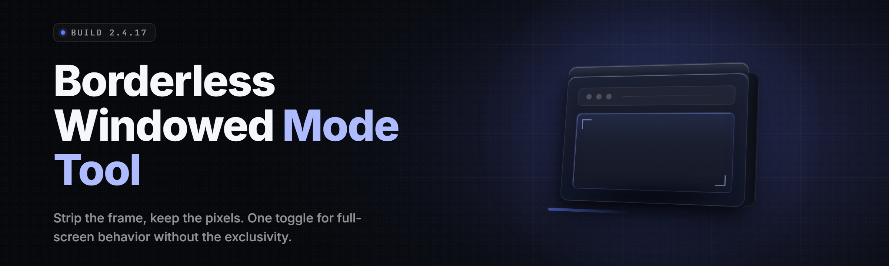

  
  
  

  

  
  
  

---

**Force any game into true borderless windowed mode. Instant alt-tab, zero flicker, no launcher hacks.**

`borderless-window-toolkit` · 2026 release · single `.exe` · extract and run

---

## 📦 All Modules Status

| Module | Status | Description |
|---|---|---|
| `bwt.core.window` | ✅ Working | Strips title bar, frame, and caption from the target window |
| `bwt.core.resolution` | ✅ Working | Matches framebuffer to native display resolution, no letterbox |
| `bwt.core.dpi` | ✅ Working | Per-monitor DPI awareness, fixes blurry stretched output |
| `bwt.hook.swapchain` | ✅ Working | DXGI/D3D11/D3D12 swapchain hook for seamless toggle |
| `bwt.hook.vulkan` | ✅ Working | VK_PRESENT_MODE_IMMEDIATE_KHR presenter override |
| `bwt.hook.opengl` | ✅ Working | Legacy WGL borderless path for older titles |
| `bwt.input.raw` | ✅ Working | Re-routes raw input so cursor never leaves the frame |
| `bwt.input.capture` | ✅ Working | Fixes mouse clipping and drop-out at window edges |
| `bwt.focus.keepalive` | ✅ Working | Prevents the game from dropping focus on alt-tab |
| `bwt.focus.nostall` | ✅ Working | Blocks the classic "minimize on unfocus" behavior |
| `bwt.profile.manager` | ✅ Working | Per-game profiles with auto-apply on process start |
| `bwt.profile.import` | ✅ Working | Import/export profiles as `.bwtp` files |
| `bwt.watch.process` | ✅ Working | Watches for process start/exit and applies/reverts |
| `bwt.tray.hotkey` | ✅ Working | Global hotkey toggle, default `Ctrl+Alt+B` |
| `bwt.overlay.hud` | ✅ Working | Minimal status overlay (resolution, FPS, state) |
| `bwt.overlay.toggle` | ✅ Working | Overlay on/off without leaving fullscreen |
| `bwt.compat.anticheat` | ✅ Working | Allow-list mode for titles that tolerate windowed mode |
| `bwt.compat.uwp` | ✅ Working | UWP / Game Pass / Store app support path |
| `bwt.compat.steam` | ✅ Working | Reads Steam library, drops per-title profiles |
| `bwt.compat.epic` | ✅ Working | Reads EGS manifests for profile targeting |
| `bwt.compat.gog` | ✅ Working | GOG Galaxy library detection |
| `bwt.restore.auto` | ✅ Working | Auto-restores original window state on exit |
| `bwt.restore.crash` | ✅ Working | Crash-safe restore via watchdog process |
| `bwt.log.diag` | ✅ Working | Diagnostic log for support tickets |
| `bwt.cli.batch` | ✅ Working | Headless CLI mode for scripting multi-title setup |
| `bwt.updater.check` | ✅ Working | Manual update check (no silent auto-update) |
| `bwt.settings.portable` | ✅ Working | Portable mode: config lives next to the `.exe` |
| `bwt.settings.registry` | ✅ Working | Optional registry install for start-with-Windows |
| `bwt.multi.monitor` | ✅ Working | Correct borderless behavior across multi-monitor setups |
| `bwt.multi.hdr` | ✅ Working | HDR-safe toggle, no washed-out colors on switch |
| `bwt.multi.vrr` | ✅ Working | Variable refresh rate (G-Sync/FreeSync) preserved |
| `bwt.scale.window` | ✅ Working | Custom windowed scale (e.g. 90% of native) |
| `bwt.scale.pixelperfect` | ✅ Working | Integer-scaling mode for pixel-art titles |

---

## 🎮 What is Borderless Windowed Mode?

| Term | Explanation |
|---|---|
| **Borderless windowed** | A window with no title bar, frame, or caption, sized to fill the screen exactly — visually identical to fullscreen, technically still a window. |
| **Fullscreen exclusive** | The legacy mode where the game takes the display device directly. Fastest, but alt-tab causes a long black flicker and mode-switch stall. |
| **Swapchain** | The buffer chain the GPU presents to the display. BWT hooks the present call to force borderless presentation. |
| **DXGI** | DirectX Graphics Infrastructure — the layer BWT intercepts for D3D10/11/12 titles. |
| **Present mode** | How the swapchain hands frames to the display (immediate, mailbox, fifo). BWT forces the borderless-friendly mode. |
| **Raw input** | The low-level input path games use for mouse. Without a fix, the cursor drifts off the window and clips. |
| **Window rect** | The pixel rectangle defining the window. Borderless mode sets it to the display bounds exactly. |

**Why builders and players use it:**

- Alt-tab is instant — no mode switch, no 5-second black screen.
- Overlays, Discord, OBS, and capture tools see a normal window and behave.
- Streaming and recording stop fighting fullscreen capture quirks.
- Multi-monitor workflows work without unplugging a second display.
- Crashes revert cleanly because the game never owned the display device.

---

## 🧩 Key Features

| Feature | Description | Benefit |
|---|---|---|
| Universal swapchain hook | D3D11, D3D12, Vulkan, and OpenGL paths | Works on new and old titles alike |
| Per-game profiles | Stored by executable hash, auto-applied | Set it once, forget it |
| Crash-safe restore | Watchdog reverts on abnormal exit | No stuck windows after a crash |
| Global hotkey | `Ctrl+Alt+B` default, rebindable | Toggle without leaving the game |
| Multi-monitor correct | Handles DPI, HDR, and VRR per display | No stretched or washed-out output |
| Steam/Epic/GOG import | Reads installed libraries | Fast profile setup for big libraries |
| Headless CLI | `bwt --apply <exe>` | Scriptable batch setup |
| HDR-safe toggle | Detects and preserves HDR state | Colors don't break on switch |
| VRR preserved | Keeps G-Sync/FreeSync active | No tearing, no judder |
| Pixel-perfect scaling | Integer scale for retro titles | Sharp sprites, no blur |
| Portable or registry | Two install styles | USB-stick friendly |
| Diagnostic log | One-click export | Faster support tickets |

---

## 🖥️ System Requirements

| Component | Minimum | Recommended |
|---|---|---|
| OS | Windows 10 21H2 (x64) | Windows 11 23H2+ |
| CPU | Dual-core 2.0 GHz | Quad-core 3.0 GHz+ |
| RAM | 4 GB | 8 GB+ |
| GPU | DirectX 11 capable | DirectX 12 / Vulkan capable |
| Display | 1280×720 | 1920×1080 @ 144 Hz or higher |
| Storage | 40 MB free | 200 MB free (logs, profiles) |
| Runtime | .NET 8 Desktop Runtime | .NET 8 Desktop Runtime |
| Permissions | Standard user | Administrator (for anti-cheat-adjacent titles) |

---

## ⚖️ Comparison

| Aspect | Fullscreen Exclusive | Alt-Enter (in-game) | This Tool |
|---|---|---|---|
| Alt-tab speed | Slow (mode switch) | Fast | Instant |
| Overlay compatibility | Poor | Varies | Excellent |
| Multi-monitor support | Manual unplug often needed | Partial | Native, per-display |
| HDR preservation | Native | Often breaks | Preserved |
| VRR (G-Sync/FreeSync) | Native | Sometimes off | Preserved |
| Crash recovery | Black screen risk | Reverts | Watchdog auto-revert |
| Per-game profiles | None | None | Built-in |
| Batch/scriptable | No | No | Yes (CLI) |

---

## 🚀 Quick Start

1. 🪟 Visit the project page and grab the latest `.exe` release.
2. 📁 Extract the archive to any folder (portable — no installer required).
3. 🎯 Launch the `.exe` and let it detect running games, or drag a game's `.exe` onto the window.
4. ⚙️ Pick a profile preset — **Native**, **90% scale**, or **Pixel-Perfect** — and click **Apply**.
5. 🎮 Alt-tab freely. Press `Ctrl+Alt+B` to toggle borderless on/off mid-session.

  

---

## 🎯 The Problem

- Alt-tabbing in fullscreen exclusive causes multi-second black flickers and stalls.
- Overlays (Discord, Steam, OBS) either don't render or capture the wrong surface.
- Games that "support" borderless often stretch, blur, or misalign on DPI-scaled displays.
- Multi-monitor setups break the mouse cursor at window edges.
- HDR and VRR settings reset every time you toggle display mode.
- Crashes leave the desktop stuck at the game's resolution or a black screen.
- Setting borderless per-title by hand is tedious across a large library.

---

## 🛠️ The Solution

| Problem | Solution |
|---|---|
| Alt-tab stalls | Borderless swapchain hook eliminates mode switches entirely |
| Overlay capture issues | Windowed presentation makes overlays see a normal window |
| Stretched / blurry output | Per-monitor DPI awareness + framebuffer match to native |
| Mouse cursor clipping | Raw input re-route plus edge-clip fix |
| HDR/VRR reset | State preservation layer detects and re-applies display settings |
| Crash leaves black screen | Watchdog process restores original window state |
| Manual per-title setup | Profile manager with Steam/Epic/GOG library import |

---

## 🧪 What is Borderless Windowed Mode? (Deep Dive)

Borderless windowed mode is not a compromise anymore. Modern GPUs present a maximized, borderless window at native resolution with the same latency characteristics as fullscreen exclusive, provided the swapchain is configured correctly. `borderless-window-toolkit` handles that configuration for you — it hooks the present call, forces the borderless-friendly present mode, and leaves the rest of the render path alone.

The result: you get fullscreen-exclusive performance without giving up alt-tab, overlays, or multi-monitor workflows.

---

## 🧭 Usage Guidelines

| Allowed | Not allowed |
|---|---|
| Single-player and offline games | Circumventing anti-cheat protections |
| Emulators, retro titles, indies | Modifying game binaries or memory |
| Streaming and recording setups | Bypassing licensing or DRM |
| LAN/co-op titles that permit windowed mode | Competitive online titles with strict anti-cheat |
| Personal and hobby use | Redistribution of modified builds without license |

> **Note:** Some online games' anti-cheat systems flag any external process that touches their swapchain. Check the compatibility table before applying to any competitive title.

---

## 🔧 Feature Groups by Category

### 🎨 Rendering & Presentation

| Feature | Effect |
|---|---|
| Swapchain present-mode override | Forces borderless-friendly present mode |
| Native framebuffer match | No letterbox, no stretch |
| Integer scaling | Crisp pixels for retro titles |
| HDR state preservation | No washed-out colors on toggle |

### 🖱️ Input & Focus

| Feature | Effect |
|---|---|
| Raw input re-route | Cursor stays inside the frame |
| Edge-clip fix | No mouse drop-out at window borders |
| Keep-alive focus | Game doesn't minimize on alt-tab |
| No-stall unfocus | No pause on losing focus |

### ⚙️ Profiles & Automation

| Feature | Effect |
|---|---|
| Per-game profile | Auto-applies on process start |
| Profile import/export | Share setups as `.bwtp` files |
| Headless CLI | Batch-apply across a library |
| Library import | Steam, Epic, GOG detected automatically |

### 🖥️ Display Compatibility

| Feature | Effect |
|---|---|
| Multi-monitor correct | Handles DPI per display |
| VRR preserved | G-Sync/FreeSync stays active |
| UWP/Game Pass support | Works with Store-packaged titles |
| Custom windowed scale | 90%, 100%, or integer only |

---

## 🧯 Known Issues

| Issue | Solution |
|---|---|
| Overlay renders behind the game | Disable the game's own overlay; use BWT's overlay toggle |
| Some UWP titles ignore the hook | Launch via the **Store Apps** tab inside the tool |
| HDR reverts to SDR on toggle | Enable **HDR Preservation** in Settings → Display |
| Multi-monitor cursor drift | Enable **Raw Input Re-route** for that profile |
| Crash leaves a stuck window | Watchdog auto-reverts; if not, run `bwt --restore` |
| Anti-cheat refuses launch | Move the title to the **Excluded** list and use in-game borderless |

---

## 🧰 Troubleshooting Flow

1. Game won't launch → Check the **Excluded** list and anti-cheat compatibility.
2. Black screen after toggle → Run `bwt --restore` from the install folder.
3. Blurry / stretched → Enable **Per-Monitor DPI** and re-apply the profile.
4. Mouse clips at edges → Toggle **Raw Input Re-route** off and on.
5. No overlay → Update GPU drivers; disable third-party overlays.
6. HDR washed out → Re-enable **HDR Preservation** and restart the game.

---

## ❓ FAQ

<strong>Is borderless windowed mode slower than fullscreen exclusive?</strong>

On modern GPUs with a properly configured swapchain, the difference is under 1% in the vast majority of titles. The tool forces the correct present mode so you don't lose frames to a misconfigured window.

<strong>Will this get me banned?</strong>

It depends on the title. The tool never touches game memory or files — it only manages window and swapchain presentation. Some competitive games with strict anti-cheat will still flag external processes, so check the compatibility list and exclude those titles.

<strong>Does it work with HDR displays?</strong>

Yes. HDR Preservation is enabled by default and detects the display's HDR state before and after toggling, so colors don't break.

<strong>Can I use it on a laptop with a secondary monitor?</strong>

Yes. Multi-monitor and per-display DPI are handled natively. Each display gets its own framebuffer match.

<strong>Do I need to install anything besides the .exe?</strong>

The only requirement is the .NET 8 Desktop Runtime. Everything else ships inside the archive.

<strong>How do I revert a game to its original mode?</strong>

Right-click the game's profile and choose **Restore Original State**, or run `bwt --restore` from the command line.

<strong>Does it work with Game Pass / Microsoft Store titles?</strong>

Yes, via the UWP compatibility path. Open the **Store Apps** tab and select the title.

<strong>What's the difference between 90% scale and Native?</strong>

Native fills the display exactly. 90% scale gives a small margin — some players prefer it for easier edge access and overlay visibility.

<strong>Can I script it across my whole library?</strong>

Yes. The headless CLI accepts a library path and applies a default profile to every detected title, skipping anything on the excluded list.

<strong>Is the config portable?</strong>

Yes. Drop the `.exe` in a folder, and profiles and settings stay alongside it. No registry writes unless you opt in.

---

## 📥 Download

  

---

## 🧾 Closing

`borderless-window-toolkit` exists because alt-tabbing shouldn't cost you five seconds of black screen and a broken overlay. It hooks the present path, preserves HDR and VRR, fixes the mouse, and gets out of the way. Set a profile once and forget the tool exists — which is exactly what a good windowed-mode utility should do.
